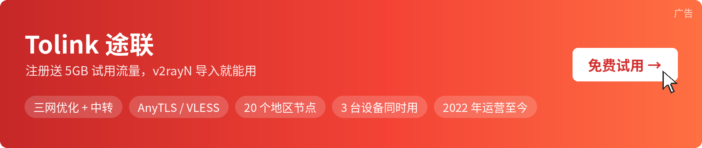

>🚀最后更新时间: 2026-11-14 14:10:04

# Tolink 免费 V2Ray 订阅（v2rayN / v2rayNG）

本仓库自动更新 Tolink 的公益免费订阅，电脑用 v2rayN、安卓用 v2rayNG，复制链接就能导入。

- 公益流量用完后，脚本会自动换上新的订阅链接，最后更新时间见第一行。
- 节点全部超时，回本页复制新链接，在客户端里重新更新订阅。

[](https://6no2fh.tolinkaff2.com/TmUpU9Tf)

| Tolink 途联 | 注册送 5GB 试用流量 · 三网优化 + 中转 · AnyTLS / VLESS · 20 个地区 · 3 台设备 | [点击注册 Tolink →](https://6no2fh.tolinkaff2.com/TmUpU9Tf) |
|---|---|---|

## 免费 V2Ray 订阅链接

>🚀免费V2Ray订阅链接（v2rayN / v2rayNG 通用，Clash、小火箭也能导入）

```
https://sxMx8G.tosslk.xyz/124f9dca6bcfd29be8d7c1b1f9064b6c
```

## v2rayN 导入订阅（Windows / macOS / Linux）

1. 从 [v2rayN 官方 Releases](https://github.com/2dust/v2rayN/releases) 下载：Windows 一般选 `v2rayN-windows-64.zip`，带 `desktop` 的是另一种界面，功能一样；Mac 是 M 系列芯片选 `v2rayN-macos-arm64.dmg`，Intel 芯片选 `v2rayN-macos-64.dmg`。
2. 打开 v2rayN，点菜单「订阅分组」→「订阅分组设置」→「添加」，「别名」随便填，把上面的链接粘贴到「可选地址 (Url)」，点「确定」。
3. 回到主界面，点「订阅分组」→「更新全部订阅（不通过代理）」，节点就会出现在列表里。
4. 在列表里按 Ctrl+A 全选，再按 Ctrl+R 测试真连接延迟；双击延迟低的节点，别名前出现「活动」标签就是在用的节点。最后在窗口底部把系统代理改成「自动配置系统代理」，路由选「绕过大陆」。

## v2rayNG 导入订阅（安卓）

Tolink 的节点分 AnyTLS 和 VLESS 两种协议。v2rayNG 目前不支持 AnyTLS，只能用其中的 VLESS 节点；想用全部节点，安卓可以改用下面表格里的 Clash Meta for Android。

1. 从 [v2rayNG 官方 Releases](https://github.com/2dust/v2rayNG/releases) 下载 apk，不确定手机架构就选 `universal` 版本。
2. 打开左上角侧边菜单 →「订阅分组」→ 右上角「+」，「备注」随便填，把链接粘贴到「URL」，点右上角的 ✓ 保存。
3. 回到主界面，先点顶部以订阅备注命名的标签，再点右上角三个点 →「更新订阅」。
4. 再点三个点 →「测试真连接延迟」，选一个有延迟数字的节点，点右下角的按钮连接；第一次会弹出网络连接请求，点「确定」。

## 其他设备

| 设备 | 客户端 | 官方下载 | 中文教程 |
|---|---|---|---|
| iPhone / iPad | Shadowrocket（小火箭） | [App Store](https://apps.apple.com/us/app/shadowrocket/id932747118)（付费，中国大陆区商店搜不到；AnyTLS 需 2.2.64 及以上版本） | — |
| 习惯用 Clash 的电脑 | Clash Verge Rev | [GitHub Releases](https://github.com/clash-verge-rev/clash-verge-rev/releases) | [Clash Verge Rev 教程](https://volya2026.github.io/proxy-client-guide/clash-verge-rev/) |
| 安卓（全部节点可用） | Clash Meta for Android | [GitHub Releases](https://github.com/MetaCubeX/ClashMetaForAndroid/releases) | [Clash Meta for Android 教程](https://volya2026.github.io/proxy-client-guide/clash-meta-for-android/) |

## 免费订阅的实际限制

- **多人共用**：晚上人多时速度明显下降，测速经常出现超时。
- **链接会换**：流量用完就换新链接，旧链接失效后要回本页重新复制。
- **只适合临时用**：查资料、看网页够用，长期办公、看视频建议用自己的账号。

想长期稳定用，可以注册自己的 Tolink 账号，拿到专属订阅，注册就送 5GB 试用流量，先试再决定：

| Tolink 途联 | 注册送 5GB 试用流量 · 三网优化 + 中转 · AnyTLS / VLESS · 20 个地区 · 3 台设备 | [点击注册 Tolink →](https://6no2fh.tolinkaff2.com/TmUpU9Tf) |
|---|---|---|

## 常见问题

**v2rayN 更新订阅后列表是空的？**<br/>
先确认链接复制完整（从 `https://` 开头到最后一个字符）；更新时选「不通过代理」；还是空的就回本页，复制最新链接替换掉旧的。

**v2rayNG 点了「更新订阅」没反应？**<br/>
要先点顶部那个订阅标签再更新。停在「Default」标签时，更新的不是这个订阅。

**为什么 v2rayNG 里的节点比 v2rayN 少？**<br/>
订阅里有 AnyTLS 和 VLESS 两种节点，v2rayN 两种都能用，v2rayNG 目前只支持 VLESS，AnyTLS 节点用不了。需要全部节点的话，安卓换成 Clash Meta for Android。

**v2rayN 的 windows-64.zip 和 windows-64-desktop.zip 选哪个？**<br/>
功能、协议和配置都一样，只是界面不同：前者是 Windows 传统界面，后者和 Mac、Linux 版外观一致。不确定就选 windows-64.zip。

**连上了但打不开网页？**<br/>
先在 v2rayN 底部确认系统代理是「自动配置系统代理」，v2rayNG 确认底部显示「已连接」；再换一个延迟低的节点试试。

## 延伸阅读

- [Tolink 机场评测](https://tuijianvpn.com/1134)：套餐、线路和使用体验的完整介绍。